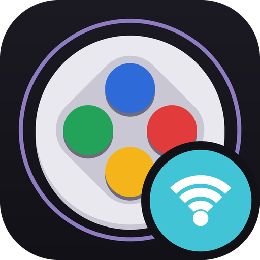

<p align="center"></p>

# HHL Gamepad WLAN

Play wirelessly on a Windows PC with a HOJA gamepad over your home network. You don't need a dongle. The gamepad joins your WLAN, and this app turns it into a real controller on the PC, in the mode the gamepad is set to (SInput or XInput). Steam and games see it like any other wired controller.

- **One portable .exe.** There's no installer, and it keeps no config files or registry settings of its own.
- **Several gamepads and several PCs.** Every gamepad on the network shows up in the list. Open one to use it here, or claim one that another PC is using.
- **Report rate:** 125, 250 or 500 Hz. Input is paced evenly, so 500 in gives a clean 500 out.
- **Config app over WLAN.** While the app is running, [HHL Gamepad Config](https://handheldlegend.github.io/hoja3/) can connect to your gamepads through it, with no cable.
- **Close to tray** and optional **Start with Windows**.

## Get it

Download `HhlGamepadWlan.exe` from the [latest release](https://github.com/HandHeldLegend/hhl-gamepad-wlan/releases/latest) and run it. Each release lists its changes. The app's footer shows whether a newer release is out.

The .exe isn't code-signed, so Windows SmartScreen may warn you the first time. Choose **More info**, then **Run anyway**.

The app asks for administrator rights. It needs them to install the virtual controller driver the first time it runs.

## Setting up a gamepad

1. Connect the gamepad over USB in [HHL Gamepad Config](https://handheldlegend.github.io/hoja3/).
2. Under **Wireless → Home WLAN**, enter your network's name and password, then save. The password can't be read back from the gamepad.
3. Start the gamepad in wireless mode. If no HOJA dongle is nearby, it joins your home network, and it appears in HHL Gamepad WLAN within a few seconds.

A gamepad that nobody opens turns itself off after 2 minutes. If an open gamepad's PC goes away, it turns off after 30 seconds.

## Removing it

Click **Remove driver** in the app's footer. This removes the virtual controllers, the driver and its certificate, and the Start with Windows task. Then delete the .exe.

## Building

You need Windows 10 or 11 (x64) and Visual Studio 2022 with **Desktop development with C++** and the Windows SDK 10.0.26100. Then:

```bat
git clone --recurse-submodules https://github.com/HandHeldLegend/hhl-gamepad-wlan
cd hhl-gamepad-wlan
build.cmd
```

`build.cmd` downloads the .NET 10 SDK and the Windows Driver Kit's NuGet package into `.tools\` and checks each against a pinned hash. Nothing is installed system-wide. To keep the tools somewhere else, set `HHL_TOOLS`. The result is `build\release\HhlGamepadWlan.exe`.

The layout:

| Path | What |
| --- | --- |
| `src/` | The app (C#, compiled ahead of time into one native .exe) |
| `native/` | The window: `hhl_ui.cpp` with [Dear ImGui](https://github.com/ocornut/imgui) |
| `external/HIDMaestro` | [HIDMaestro](https://github.com/hifihedgehog/HIDMaestro), the virtual controller driver, pinned |
| `patches/` | Our build changes to HIDMaestro |
| `tools/make_icon.py` | Draws `src/app.ico` and `assets/icon-512.png` |

See [THIRD-PARTY-NOTICES.txt](THIRD-PARTY-NOTICES.txt) for the software this includes.
